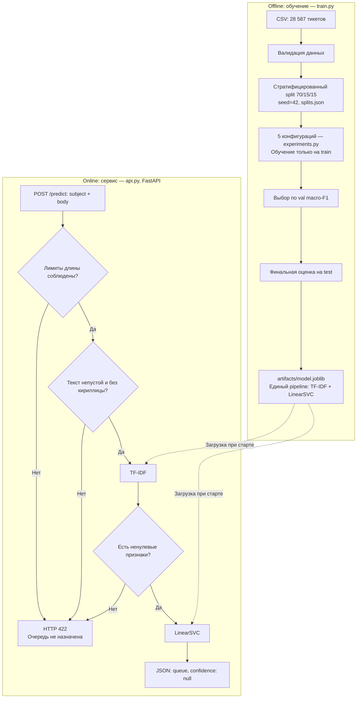

# Архитектура

## Бизнес-задача

Обращения в службу поддержки поступают в общую очередь. Оператор вручную
направляет каждое обращение в профильное подразделение. Задача системы —
по тексту обращения (тема + описание) автоматически предлагать подразделение
(queue) для маршрутизации: Technical Support, Product Support, Customer Service,
Billing and Payments и др.

## Общая схема

## Компоненты

| Компонент | Файл | Назначение |
|---|---|---|
| Данные | `src/ticket_router/data.py` | валидация схемы, объединение subject+body, стратифицированный split, sha256 данных |
| Признаки | `src/ticket_router/features.py` | `CombinedTfidf` — конкатенация словного и символьного TF-IDF |
| Эксперименты | `src/ticket_router/experiments.py` | 5 конфигураций: baseline, LogReg ×2, LinearSVC, LinearSVC + подбор C |
| Обучение | `src/ticket_router/train.py` | запуск экспериментов, выбор по val, тест лучшей модели, сохранение артефакта и метрик |
| Инференс | `src/ticket_router/predict.py` | загрузка артефакта, предсказание одного тикета |
| API | `src/ticket_router/api.py` | FastAPI: `/predict`, `/health`, `/ready`, `/metrics` |

## Ключевые решения

1. **Только subject + body как признаки.** Колонки `answer`, `type`, `priority`,
   `tag_*` исключены: в момент маршрутизации нового обращения их не существует.
   Их использование — классическая утечка данных, завышающая метрики.
2. **Единый pipeline sklearn** (векторизация + классификатор) сохраняется одним
   артефактом `model.joblib`: предобработка и модель не расходятся между
   обучением и инференсом.
3. **Одно фиксированное разбиение** для всех экспериментов (seed=42, индексы
   в `experiments/splits.json`): модели сравниваются на одних выборках.
   Точные тексты между выборками не повторяются; одна пара совпадает после
   нормализации регистра/пробелов — остаточный риск, сохранённый в аудите.
4. **Выбор модели по val, оценка на test один раз** — защита от переобучения
   на тесте.
5. **Словный + символьный TF-IDF**: символьные 3–5-граммы помогают с опечатками,
   кодами ошибок и смешанными языками; `class_weight="balanced"` — из-за
   дисбаланса классов (8362 у Technical Support против 405 у General Inquiry).
6. **Macro-F1 как основная метрика**: метрика усредняет F1 по классам и не даёт
   доминировать частым очередям — важно для маршрутизации редких, но
   самостоятельных подразделений.

## Ограничения текущей архитектуры

- Модель не выдаёт калиброванные вероятности (LinearSVC), поэтому порог
  «уверенности» для маршрутизации на ручную обработку пока не реализован.
- Есть отказ для кириллицы и нулевого вектора признаков. Это защита от
  заведомо неподдерживаемого ввода, а не оценка уверенности классификатора.
- Реальная интеграция с очередью тикетов не реализована. Следующий компонент —
  диспетчер, который создаёт тикет в предложенной очереди или передаёт отказ
  оператору. Учебный API ограничивается рекомендацией `queue`.
- Один артефакт без версионирования через model registry; воспроизводимость
  обеспечивается `uv.lock` + sha256 данных + splits.json.

## Выбор стека

Python и scikit-learn позволяют сравнить простые модели на CPU; TF-IDF не
требует внешнего языкового API, GPU и платных сервисов. LinearSVC выбран по
val macro-F1, а не по удобству демо. FastAPI даёт типизированный контракт и
интерактивную документацию; pytest проверяет данные, модель и HTTP-сценарии.
uv.lock фиксирует зависимости, Docker описывает переносимый запуск.
Данные синтетические: перенос качества на реальные обращения не доказан.
